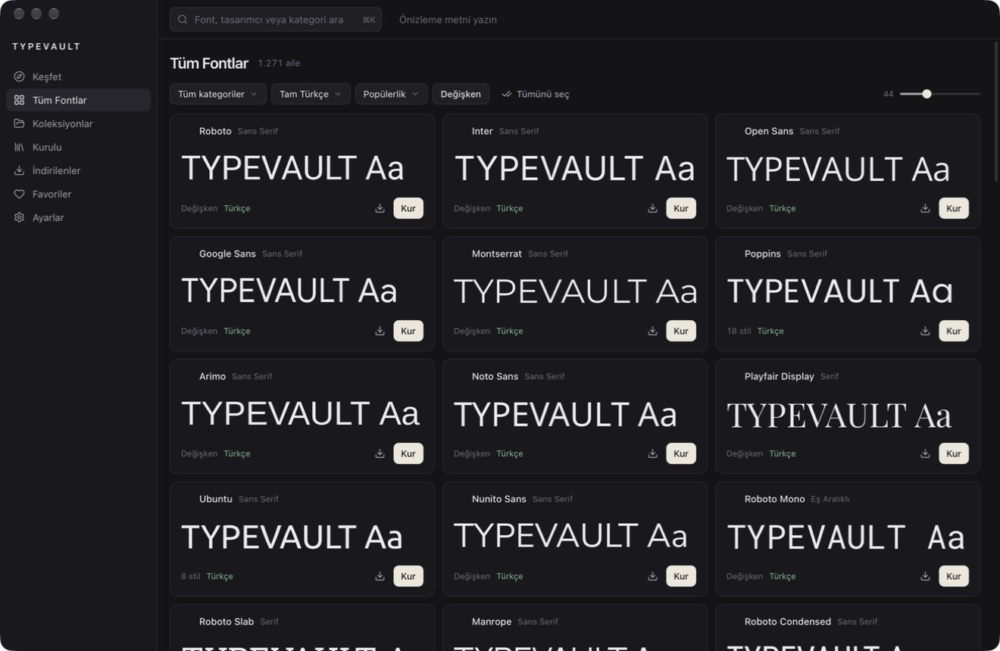

# TYPEVAULT

Türkçe arayüzlü, açık kaynak font kütüphanesi ve yöneticisi. Fontu bul, **Kur**'a bas, tasarım uygulamanda kullan.



## Özellikler

- Google Fonts kataloğundan 1.900'den fazla aile, yerelde aranabilir SQLite veritabanı
- Tek tıkla indirme ve yönetici izni gerektirmeyen kalıcı kurulum
- Koleksiyonları toplu kurma, başarısız olanları tek tek raporlama ve yeniden deneme
- Kaldığı yerden süren indirmeler, duraklatma ve iptal
- Türkçe glif denetimi: `ç Ç ğ Ğ ı İ i I ö Ö ş Ş ü Ü` karakterlerinin tamamı yoksa "tam" denmez
- Değişken font eksenleri, özel metin ve karakter önizlemeleri
- Lisans doğrulaması ve yalnız TYPEVAULT'un kurduğu fontları kaldırma

## Platformlar

| Platform | Durum |
| --- | --- |
| macOS (Apple Silicon) | Çalışıyor |
| Windows | Planlandı, [geçiş rehberi](docs/WINDOWS.md) |

## Geliştirme

```bash
npm install
npm run tauri dev
```

Dağıtım paketi `src-tauri/target/release/bundle/` altında oluşur:

```bash
npm run tauri build
```

Xcode lisansı kabul edilmemişse `.cargo/config.toml` derlemeyi Komut Satırı Araçları'na yönlendirir. Paket yalnızca geçici imzayla (`-`) imzalanır; başka Mac'lere dağıtmak için Developer ID ile imzalanıp notarize edilmelidir.

## Veri kaynakları

| Veri | Kaynak |
| --- | --- |
| Katalog | `fonts.google.com/metadata/fonts`; API anahtarı girilirse Google Fonts Developer API de eklenir |
| Lisans ve glif kapsamı | `fonts.google.com/metadata/fonts/<aile>` |
| Sınıflandırma etiketleri | `github.com/google/fonts` içindeki `tags/all/families.csv` |
| Font dosyaları | `fonts.google.com/download/list` manifesti, `fonts.gstatic.com` üzerinden TTF/OTF |

## Kurulum modeli

Dosya doğrulanır, `~/Library/Fonts/TYPEVAULT/<aile>/` altına kopyalanır, `CTFontManagerRegisterFontURLs` ile kalıcı kapsamda kaydedilir ve `CTFontManagerGetScopeForURL` ile teyit edilir. Yönetici izni gerekmez. Başka kaynaktan kurulu fontlar `external` olarak işaretlenir, değiştirilmez ve kaldırılamaz.

## Lisans

Kaynak kod [MIT](LICENSE) lisanslıdır. Fontlar bu depoda yer almaz; her font kendi lisansına tabidir ve lisans metni indirilen dosyalarla birlikte saklanır.

TYPEVAULT, Google ile bağlantılı değildir. Google Fonts adı sahibinin ticari markasıdır. Katalog için kullanılan bazı uç noktalar resmî değildir ve haber verilmeden değişebilir.
